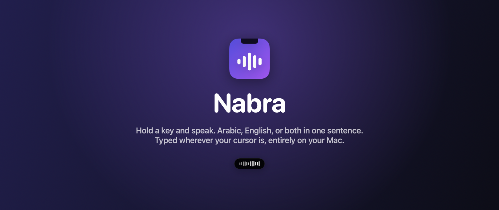
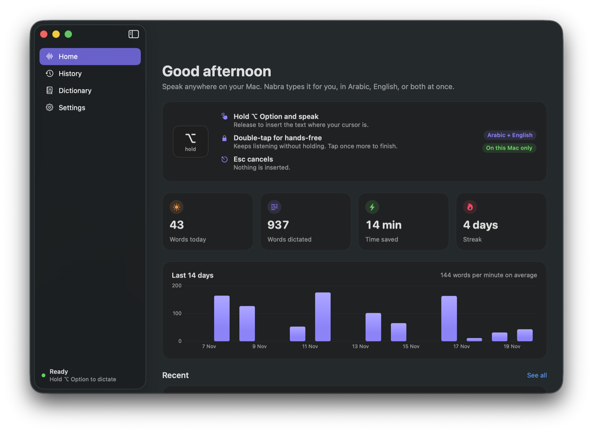
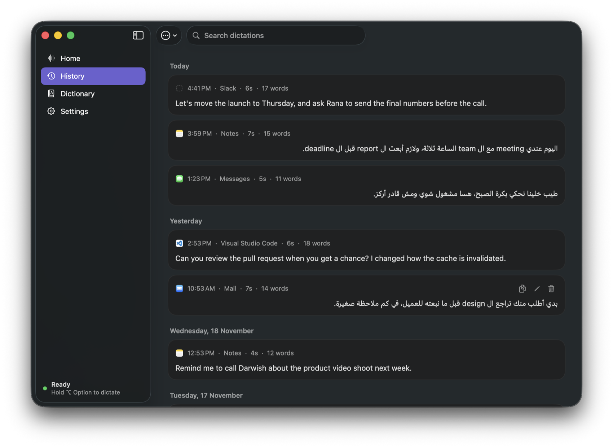
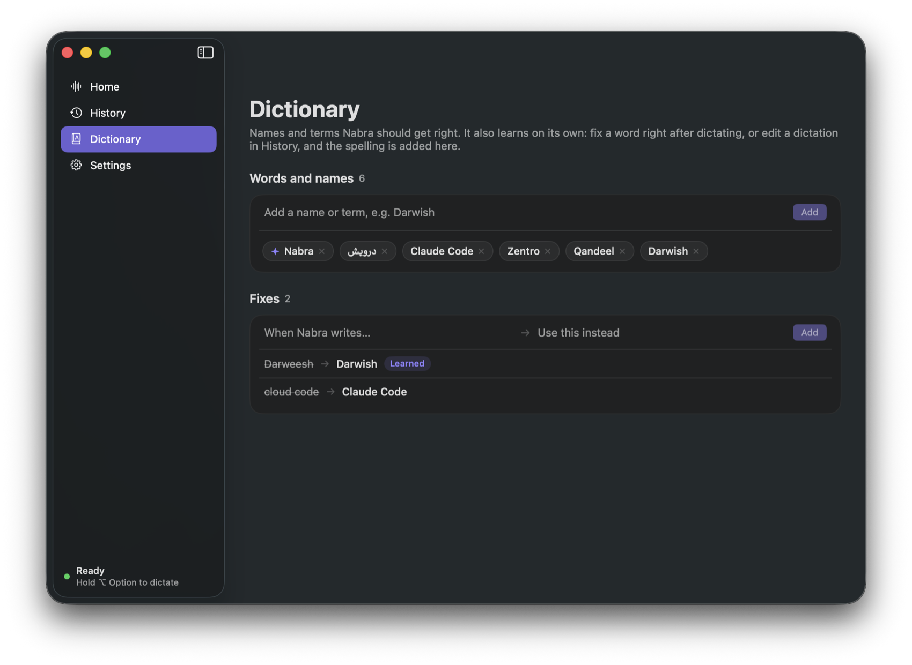

<p align="center">
  
</p>

<p align="center">
  <a href="LICENSE"></a>
  
  <a href="https://github.com/spooter99/nabra/actions/workflows/ci.yml"></a>
</p>

**Nabra** (نبرة, "tone of voice") is push-to-talk dictation for the Mac. Hold a key, speak, release, and the text is typed into whatever app you are using. It understands Arabic dialects, English, and both mixed in one sentence, and it runs entirely on your Mac: no account, no cloud, no audio leaving the machine.

<p align="center">
  
</p>

## What it does

- **Arabic, English, and both at once.** Levantine, Egyptian, Gulf and formal Arabic, English, and sentences that switch between them. English words inside Arabic stay in Latin script, and an Arabic name said inside an English sentence is written in Arabic ("Ask درويش about it").
- **Fast.** Recognition runs while you are still speaking, so text typically appears 0.25 to 0.5 seconds after you release the key (measured on an M5 MacBook Pro), and immediately if you pause first.
- **Works in every app.** Text is inserted at the cursor, with spacing and capitals adjusted to fit what is already there. Your clipboard is put back afterwards.
- **Learns your names.** Fix a word right after dictating, or edit a transcript in History, and the spelling is added to your dictionary. Near-misses are then corrected automatically ("Darwesh" becomes "Darwish").
- **Scribe: say it, get it written.** Hold a second key (Right Command by default) and your words come back cleaned up: grammar fixed, fillers and false starts gone, in the language and dialect you spoke. Ask for something ("write an email to Sara saying the report is late") and you get that text, ready to send. The pill opens up and shows it as it is written. It runs on Gemma 4 E2B, a small open model, on your Mac.
- **Understands "no, actually…".** Say "let's meet at two, no actually three" and you get "let's meet at three". (English only, macOS 26.)
- **Formats as you speak.** Say "here's the list: one, potatoes, two, vegetables" or "First, … Second, … Finally, …" and you get a numbered list, one item per line. Works in Arabic too ("أولاً… ثانياً…", "أول شي… ثاني شي…", "واحد… اثنين…"). Announce a list without numbers ("Here is the list. I need potatoes, vegetables and a couple of snacks") and you get bullet points. Ordinary sentences such as "one apple and two oranges" are left alone. "New line" and "new paragraph" break lines ("سطر جديد"), and a long dictation is split into paragraphs where you move on to a new point ("Secondly, …", "And also, …", "ثانياً…").
- **Writes addresses the way you type them.** "team at zentro dot chat" becomes team@zentro.chat, "whatsapp dot com" becomes whatsapp.com.
- **Never loses what you said.** If no text box has the cursor, the text goes to the clipboard and the pill tells you. If nothing was caught, "Try again" on the pill (or in the menu bar) reads the same recording once more.
- **Stays out of the way.** A small pill at the bottom of the screen shows a waveform while you speak. It can live under the notch instead.
- **Private and light.** One 1.56 GB model on disk, about 190 MB of memory while in use, under 1% CPU when idle. Everything you dictate is saved to a searchable history that never leaves your Mac.

<p align="center">
  
  
  
</p>

## Install

**You need:** a Mac with Apple Silicon, macOS 15 or later, [Xcode 26](https://apps.apple.com/app/xcode/id497799835) (open it once after installing), and [Homebrew](https://brew.sh).

```bash
git clone https://github.com/spooter99/nabra.git
cd nabra
scripts/install.sh
```

That builds Nabra, puts it in `/Applications`, and opens it. The first build takes a few minutes because it compiles the speech engine; any missing build tools are installed with Homebrew.

On first launch Nabra walks you through three steps:

1. **Microphone**: click Allow.
2. **Accessibility**: this lets Nabra see your dictation key and type into other apps. Switch Nabra on in the list that opens.
3. **Speech model**: a one-time 1.56 GB download. After that Nabra works offline.

Then click into any text field, hold <kbd>⌥ Option</kbd>, and talk.

> **Rebuilding later?** By default the app is signed ad hoc, and macOS treats each rebuild as a new app and asks for the two permissions again. To avoid that, sign with your own identity: see [`Config/Signing.xcconfig`](Config/Signing.xcconfig).

## Using it

| Gesture | What happens |
|---|---|
| Hold <kbd>⌥</kbd> and speak, then release | Text is inserted at the cursor |
| Double-tap <kbd>⌥</kbd> | Hands-free: keeps listening until you tap <kbd>⌥</kbd> again |
| <kbd>Esc</kbd> while recording | Cancels, nothing is inserted |
| Hold right <kbd>⌘</kbd> and speak, then release | Scribe: the text comes back written up, or written for you |

The microphone is switched on the moment the key goes down. With the left Option key the indicator appears 0.16 seconds later, once it is clear the press is not a shortcut such as <kbd>⌥</kbd><kbd>←</kbd> or <kbd>⌥</kbd><kbd>⌫</kbd>; those never trigger dictation. The indicator comes alive, and the start sound plays, when the microphone is really hearing you: a built-in microphone needs about a fifth of a second to start. You can press again while the previous dictation is still being typed; the texts arrive in order. Both keys can be changed in Settings: pick a preset, or click the shortcut and press what you want, one key or several held together (for example ⌃⌥). When you let go, it keeps listening until you have finished the word you were saying, for at most half a second, so the end is not cut off; if you had already stopped, the text comes at once.

<p align="center">
  
  
</p>

Settings also cover the language (Arabic + English, Arabic only, English only), the indicator position, sound volume, microphone, how long recordings are kept, and launching at login. If you tend to start speaking the instant you press the key, set "Microphone is on" to stay on for a minute after each dictation, or always: then not even the first syllable is missed, at the price of macOS showing its orange microphone dot for that time.

## Accuracy

Measured on 76 public test clips, 13.7 minutes in total, against Whisper large-v3-turbo (whisper.cpp, beam size 5). Word error rate, lower is better:

| | Whisper large-v3-turbo | Nabra |
|---|---:|---:|
| Levantine dialect | 39.0% | **29.3%** |
| Arabic and English mixed | 55.2% | **48.2%** |
| Egyptian dialect | 25.2% | **20.2%** |
| Gulf dialect | 39.8% | **25.0%** |
| Formal Arabic | 10.8% | **4.6%** |
| English | 2.5% | **1.0%** |
| English with an Arabic accent | 14.5% | **9.1%** |
| Text invented on silence | 3 of 4 clips | **0 of 4** |

Read these as a comparison, not as absolute quality. The set is small, and dialect has no standard spelling, so a correct transcript often counts as wrong for both systems. Sources, licences and how to rebuild the set are in [`eval/data/SOURCES.md`](eval/data/SOURCES.md).

## How it works

```
key held ─▶ microphone ─▶ voice detection ─▶ speech model (twice) ─▶ pick and weave ─▶ tidy text ─▶ insert at cursor
                                                                                            └─▶ history, learning
```

- **Speech model.** [Cohere Transcribe Arabic](https://huggingface.co/CohereLabs/cohere-transcribe-arabic-07-2026), a 2-billion-parameter open model for Arabic dialects and English, in a 4-bit build running on the GPU through [transcribe.cpp](https://github.com/handy-computer/transcribe.cpp). The weights are memory-mapped, which is why memory use stays low.
- **Ready when you release.** Every time you pause, the audio so far is decoded in the background. Long dictations are committed piece by piece, so only the last few seconds are ever pending.
- **Choosing the language.** The model needs to be told "Arabic" or "English", and if told wrong it translates instead of transcribing. Judging the language from the sound alone turned out to be unreliable: an accent, or someone else talking nearby, fools it. So in mixed mode Nabra decodes each stretch under both hints and compares. If both wrote the same script, the choice is easy. If one wrote English and the other Arabic, one of them is translating, and the model is far less sure of a translation than of a transcript. When the two are close, each text is also scored under the other hint, which separates the cases much better. The two decodes share one encoder pass, so this costs about a third more time, not double.
- **Weaving.** Say an Arabic name in an English sentence and neither decode is right: one mishears the name, the other mangles the sentence around it. Each decode knows when every word was heard (read from the decoder's attention) and how sure the model was of it. An unsure word in the English decode is matched to a confident Arabic word heard at the same moment, and the model then scores the combined sentence. The swap is kept only if the model itself finds the combined sentence more likely.
- **Self-corrections.** When a sentence contains a correction phrase, the language model built into macOS rewrites it. The rewrite is used only if it removes words around that phrase and leaves everything else exactly as spoken. Anything else (an answer, a summary, dropped content) is rejected and your words go in untouched.
- **Scribe.** A fixed rule, not the model, decides whether you asked for a text ("write an email…", "reply saying…", "make this a list", "اكتبلي رسالة…") or dictated one; questions and requests meant for someone else are never answered. Then Gemma 4 E2B either polishes what you said or writes what you asked for, told which languages you spoke so it never translates. Its output is checked, and anything that changed the language, dropped an English word from an Arabic sentence, or reads like an answer goes in as you said it. The model runs in a separate helper (llama.cpp's server) that loads while you talk, frees its memory after a minute idle, and quits after ten.
- **Learning.** After inserting, Nabra watches that text field for about a minute. If you replace a word with a similar one, it is added to the dictionary.

`vendor/patches` holds a change to the engine that reports each piece of text with its probability and its position in the audio, lets a second decode reuse the first one's encoder output, and lets the model score a transcript it is handed.

## Privacy

Nabra makes one kind of network request: downloading models from Hugging Face (the speech model, Scribe's writing model if you use Scribe, and one small helper model at build time). It contains no analytics and no telemetry. Audio, transcripts and your dictionary are stored only under `~/Library/Application Support/Nabra`, and you can delete them from Settings.

## Development

```bash
scripts/build.sh                 # build only, to build/Products/Release/Nabra.app
scripts/install.sh --background  # build, install, relaunch without raising the window

APP=build/Products/Release/Nabra.app/Contents/MacOS/Nabra
$APP --selftest                              # logic checks: gestures, key monitoring, text rules, learning, safety guards
scripts/check-loop.sh                        # the whole loop, unattended: key press to text, with a spoken clip as the microphone
scripts/check-loop.sh --microphone           # the same with the real microphone; the log shows how fast it starts
$APP --simulate clip.wav                     # play a file through the live pipeline in real time
$APP --polish "Meet at two, no actually three."
$APP --probe clip.wav --model <model.gguf>   # both decodes word by word: times, confidence, cross scores
$APP --format "here is the list. I need milk, eggs and bread"   # the text clean-up on its own
$APP --scribe "write an email to Sara saying the report is late"  # Scribe on its own (needs its model)
$APP --eval eval/data/manifest.jsonl --mode auto --out out.jsonl && python3 eval/score.py out.jsonl
```

The code is organised by what it does: `Nabra/Core/Hotkey` (key gestures), `Core/Audio` (capture), `Core/ASR` (recognition and language choice), `Core/Text` (clean-up, lists, self-corrections), `Core/Insert` (typing into other apps), `Core/Learning` (dictionary learning), `Core/Store` (history and settings), and `UI`. See [CONTRIBUTING.md](CONTRIBUTING.md).

## Limits

- Apple Silicon only. Developed and tested on macOS 26; it builds for macOS 15 but has not been run there.
- Self-correction rewriting is English only and needs macOS 26 with Apple Intelligence turned on.
- A microphone that has just been switched on is deaf for a moment (about 0.2 seconds for a MacBook's own). Nabra opens it the instant the key goes down and shows when it is hearing, but words spoken in that first moment are lost unless the microphone is set to stay on.
- Learning from corrections needs an app that exposes its text field through Accessibility. Terminals are skipped.
- The dictionary fixes spelling after recognition; the model itself cannot be primed with vocabulary.
- A sentence spoken much more quietly than the rest of a dictation can be skipped.
- Weaving goes one way: Arabic words into English sentences. An English phrase inside an Arabic sentence is left to the model, which usually keeps it in Latin script but sometimes writes it in Arabic letters or translates it.
- Scribe's model needs about 1.7 GB of memory while it is loaded (Activity Monitor shows less, as most of it is the model file mapped from disk) and 2.9 GB on disk. It is loaded only while you use Scribe.

## Licence and credits

Nabra is released under the [Apache License 2.0](LICENSE).

It stands on [transcribe.cpp](https://github.com/handy-computer/transcribe.cpp), [llama.cpp](https://github.com/ggml-org/llama.cpp) and [ggml](https://github.com/ggml-org/ggml) (MIT), [Cohere Transcribe Arabic](https://huggingface.co/CohereLabs/cohere-transcribe-arabic-07-2026) and [Gemma 4](https://huggingface.co/ggml-org/gemma-4-E2B-it-GGUF) (Apache-2.0), and [Silero VAD](https://github.com/snakers4/silero-vad) (MIT). Details are in [NOTICE](NOTICE).
